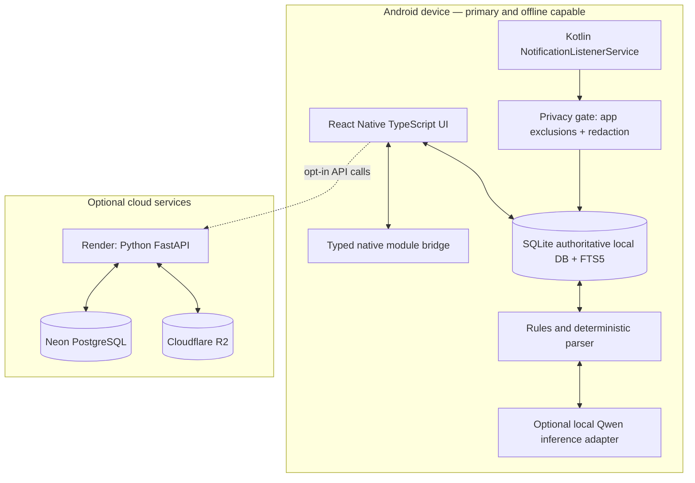

# System Architecture

## High-level design

## Key architectural decisions
1. Android listener runs as a native service and persists events without requiring React Native JS to be active.
2. SQLite on device is the source of truth for notification history.
3. Python backend is not in the real-time capture path.
4. Neon stores accounts, user settings, subscription metadata and sync cursors only in early versions.
5. R2 is for encrypted export archives, user backups and downloadable model artifacts; not a raw notification bucket.
6. Local AI is optional and asynchronous. Deterministic rules provide baseline functionality.
7. Backend free-tier cold starts must not affect core UX.

## Event pipeline
1. Android posts notification.
2. Listener checks connection state and app package.
3. App exclusion is checked before content extraction/persistence.
4. Extract only permitted extras; redact or discard sensitive values.
5. Generate a stable event identifier and dedupe key.
6. Persist raw-permitted event metadata to SQLite.
7. Queue parsing/classification outside the listener callback.
8. Store derived category, priority, confidence and model version separately.
9. Update FTS index and UI observable state.
10. Optional digest/insight tasks aggregate local records.

## Failure modes
- Listener disconnected: display warning and last-capture timestamp; never claim history is complete.
- Database unavailable: capture minimal safe diagnostic, retry boundedly; never log content.
- Model unavailable/low RAM: deterministic fallback.
- Network unavailable: all local features remain usable.
- Cloud free service sleeping: show “cloud feature waking up” or retry; do not block local operations.
